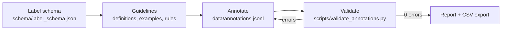

# Multilingual Data Annotation — Spanish · English · French

[](https://github.com/IvanRHG/multilingual-data-annotation/actions/workflows/tests.yml)

A small, fully documented annotation project: 64 short customer-feedback texts in Spanish, English, French, and mixed-language form, each labeled for **language, content type, sentiment, intent, and topic**. Every label follows written guidelines and is checked by an automated validator.

> **Project type:** personal, demonstrative project. All texts are **original and fictional**, written for this repository. They do not come from real customers, companies, or existing datasets, and contain no personal data.

## Problem

Training and evaluating language models depends on labeled data, and labeled data is only useful when it is **consistent**. Most inconsistency does not come from obvious cases. It comes from the borderline ones:

- *“Buen producto, pero el envío tardó el doble.”* Positive or negative? Complaint about the product or about delivery?
- *“Pouvez-vous m'envoyer la facture ?”* A question, or a request?
- *“Qué servicio tan ‘eficiente’.”* Literal praise, or sarcasm?
- *“Je suis trop happy avec ma commande.”* French, or mixed language?

This project shows a complete workflow for these decisions: a label schema, written rules with examples and counter-examples, an annotated dataset where hard cases are flagged and explained, and a script that enforces the rules.

## Objectives

1. Define a clear, closed label set for five annotation tasks.
2. Write guidelines precise enough for another annotator to reproduce the labels.
3. Annotate a balanced trilingual sample, including deliberately difficult cases.
4. Record uncertainty honestly: mark ambiguous items and explain the decision.
5. Validate the dataset automatically (schema, consistency, personal-data patterns).

## Annotation tasks

| Task | Labels |
|---|---|
| Language identification | `es`, `en`, `fr`, `mixed` |
| Text classification (content type) | `product_review`, `support_message`, `survey_comment`, `social_post` |
| Sentiment | `positive`, `negative`, `neutral`, `mixed` |
| Intent | `complaint`, `praise`, `opinion`, `question`, `request`, `suggestion`, `information` |
| Topic | `billing`, `delivery`, `product_quality`, `account_access`, `customer_service`, `app_experience`, `other` |

Definitions, positive and negative examples, and tie-breaking rules for each task are in **[guidelines/ANNOTATION_GUIDELINES.md](guidelines/ANNOTATION_GUIDELINES.md)**.

## Methodology



**How ambiguous cases are handled**

1. Apply the numbered rules in the guidelines (for example, rule **4.3**: in “X, but Y”, the clause after *but* carries the main point).
2. If a rule settles the case, cite it in `notes`.
3. If it is still uncertain, choose the best label, set `ambiguous: true`, and write down the alternative and the reason.

5 of the 64 items are marked ambiguous. Examples:

| id | Text | Decision |
|---|---|---|
| `fr-001` | Ma commande est arrivée cassée. Je souhaite un remboursement. | Topic `delivery`, not `product_quality`: *arrivée cassée* points to transport damage. Intent `request` (rule 4.2). |
| `fr-010` | Je n'arrive pas à me connecter depuis la mise à jour. | Topic `account_access`: label the symptom, not the suspected cause (rule 5.1). |
| `fr-021` | Je suis trop happy avec ma commande, merci ! | Language `fr`: one common anglicism does not make a text mixed (rule 2.2). |

## Data format

One JSON object per line (`data/annotations.jsonl`). The same records are exported to `data/annotations.csv`.

```json
{"id": "es-005", "text": "Buen producto, pero el envío tardó el doble de lo prometido.", "language": "es", "content_type": "product_review", "sentiment": "mixed", "intent": "complaint", "topic": "delivery", "ambiguous": false, "notes": "Contrastive 'pero': the second clause carries the main point (rule 4.3)."}
```

| Field | Type | Description |
|---|---|---|
| `id` | string | `es-`, `en-`, `fr-`, or `mx-` prefix + number |
| `text` | string | The text being labeled (max. 500 characters) |
| `language` … `topic` | string | One label from the schema |
| `ambiguous` | boolean | `true` if the guidelines did not fully settle the case |
| `notes` | string | Reasoning. Required when `ambiguous` is `true` or `language` is `mixed` |

## Dataset summary

| | es | en | fr | mixed | Total |
|---|---:|---:|---:|---:|---:|
| Items | 20 | 20 | 21 | 3 | **64** |

Full label distribution: **[reports/validation_report.md](reports/validation_report.md)**.

## Validation

`scripts/validate_annotations.py` uses only the Python standard library.

| Check | Severity |
|---|---|
| Valid JSON, required fields, correct types, no unexpected fields | Error |
| Every label is in the allowed set | Error |
| Unique ids and unique texts | Error |
| id prefix matches the language label | Error |
| `praise` → positive; `complaint` → negative or mixed; `opinion` → neutral or mixed | Error |
| `notes` present for ambiguous and mixed-language items | Error |
| No email addresses, phone numbers, or URLs in the text | Error |
| A function-word heuristic agrees with the language label | Warning |

Current result on the committed dataset:

```text
64 valid records, 0 errors, 0 warnings
```

The language heuristic is deliberately simple. It makes a confident guess on 59 of the 61 monolingual items, and all 59 guesses agree with the labels. It cannot judge very short texts such as *“Vous livrez en Belgique ?”*, which is why it only produces warnings.

## Project structure

```text
multilingual-data-annotation/
├── data/
│   ├── annotations.jsonl          # source of truth
│   └── annotations.csv            # export, regenerated by the validator
├── guidelines/ANNOTATION_GUIDELINES.md
├── schema/label_schema.json       # allowed labels and consistency rules
├── reports/validation_report.md   # label distribution, errors, warnings
├── scripts/validate_annotations.py
└── tests/test_validate_annotations.py   # 22 tests (pytest)
```

## Usage

Requires Python 3.10+. The validator itself needs no extra packages. `pytest` is only needed for the tests.

```bash
git clone https://github.com/IvanRHG/multilingual-data-annotation.git
cd multilingual-data-annotation

python scripts/validate_annotations.py
python scripts/validate_annotations.py --report reports/validation_report.md --csv data/annotations.csv

pip install pytest
python -m pytest
```

The validator exits with code `0` when there are no errors and `1` otherwise, so it can run in CI.

## Technologies

Python 3 (standard library) · JSONL / CSV · pytest · Markdown · Mermaid

## Limitations

- **Single annotator.** There is no second independent annotation, so inter-annotator agreement (for example, Cohen's kappa) cannot be measured yet.
- **Small sample.** 64 items demonstrate the workflow. They are not enough to train a model.
- **Short texts only.** Long, multi-topic documents would need span-level labels, which this schema does not cover.
- **The language heuristic** is a sanity check, not a language-identification model.

## Possible improvements

- Have a second annotator label the same items independently and report agreement per task.
- Add an adjudication step for disagreements and update the guidelines with the outcome.
- Add Portuguese or Italian to extend the multilingual coverage.
- Run the validator with GitHub Actions on every pull request.

## License

Code: MIT. Texts and annotations: CC BY 4.0.
